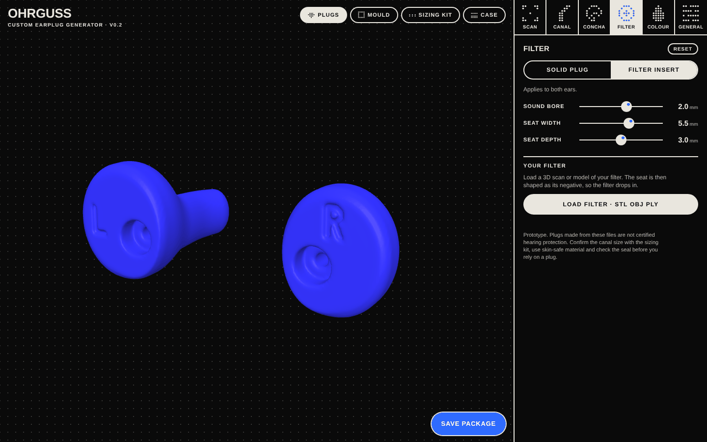
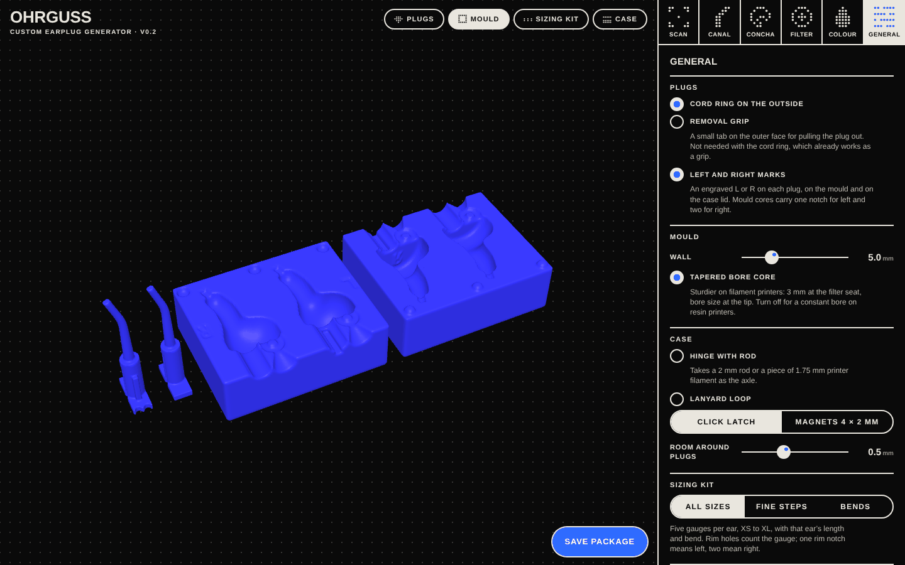
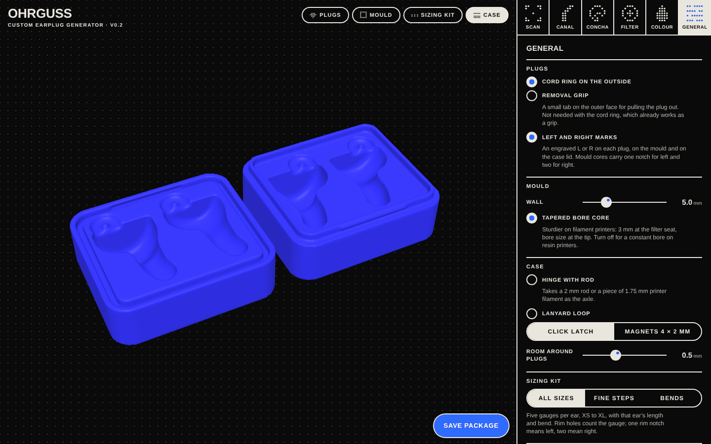
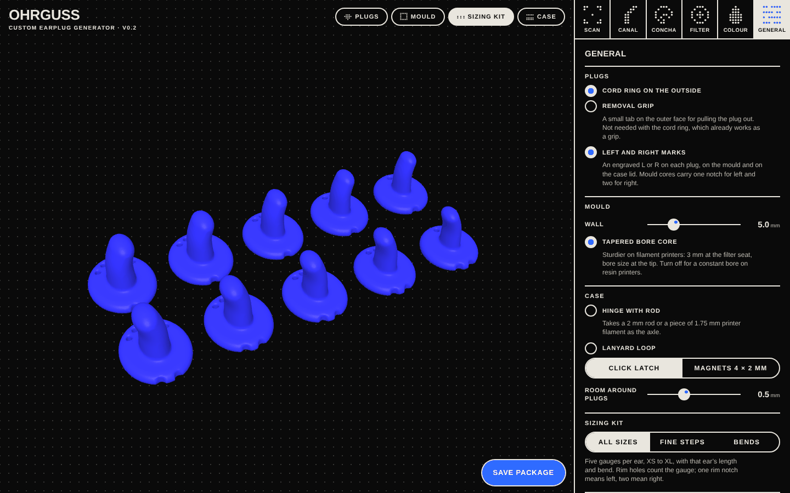

# OHRGUSS

**Custom-fit earplugs from a browser.** Design a pair of earplugs for your ears and download print files for the plugs, a silicone mould, a fitted case and a sizing kit.

**[Open the app](https://smoaf.github.io/OHRGUSS/)** · [Offline version](https://smoaf.github.io/OHRGUSS/ohrguss-offline.html) · [Printing and casting guide](docs/printing.md) · [Concept and research](docs/concept.md)



> [!WARNING]
> **Prototype. Not certified hearing protection.** Plugs made from these files have no tested attenuation. Use certified hearing protection wherever protection is required, for example at work. Confirm the canal size with the sizing kit, use skin-safe materials, and check the seal before relying on a plug.

## What it does

- **One design for both ears.** Canal and concha are set per ear; filter, extras and colour are shared.
- **Canal library.** 15 canal variants (5 sizes × 3 bends), based on published ear-canal measurements, plus fine tuning.
- **Scan or photo.** Load one 3D scan of your ear or head and mark each canal opening, or place a true-size photo per ear using a coin for scale.
- **Filter or solid.** A filter seat and sound bore, shaped as a cylinder or from a 3D scan of your own filter. Or a solid plug with an optional pressure vent.
- **Extras.** Cord ring or removal grip on the outside, engraved L and R marks.
- **Mould.** One closed two-part mould for both plugs, with a separate keyed core per ear that forms the filter seat and bore.
- **Case.** Shaped to your two plugs and clicks shut; optional hinge, lanyard loop or magnets.
- **Sizing kit.** Two rows of canal gauges, one per ear: all sizes, fine size steps or bend steps.
- **One package.** A single zip with all STL files, a readme and your design file.

| Mould | Case | Sizing kit |
|---|---|---|
|  |  |  |

## How to use it

1. **Size:** print the sizing kit (Sizing kit tab → Save package) and find the canal gauge that seals comfortably in each ear.
2. **Canal:** in **Canal**, pick that size and bend for each ear with the Left/Right switch.
3. **Concha:** in **Concha**, adjust width, height and thickness. With a scan or photo loaded (**Scan**), match the plug to your ear.
4. **Filter:** in **Filter**, choose a filter insert or a solid plug. Load a scan of your filter if you have one.
5. **Extras:** in **General**, switch on the cord ring or grip, marks, and the mould and case options.
6. **Save package** and follow the [printing and casting guide](docs/printing.md).

The app works on phones too. Your settings are kept in your browser; the design file in each package lets you continue on another device.

## Project status

Version 0.2, a working prototype.

- **Tested:** every part comes out as a closed, single-piece mesh across a range of designs (automatic tests on each push); the app runs in desktop and phone browsers.
- **Not tested yet:** printing and casting, real ear scans, ear photos and filter scans. Tolerances for the click latch, hinge, magnets and mould cores will need tuning on real printers.

Feedback from test prints is the most useful contribution right now. Please open an issue with your printer, material, and what fitted or did not.

## Development

The app is plain HTML, CSS and JavaScript with no build step. Only [three.js](https://threejs.org/) r128 is loaded, from a CDN.

### Structure

```
web/                    The site, served as-is by GitHub Pages
  index.html            Markup
  css/ohrguss.css       Styles
  js/core.js            Geometry engine: plugs, mould, case, sizing kit, STL and zip export
  js/app.js             Interface: menus, 3D preview, scan/photo/filter import, export
scripts/
  serve.mjs             Local development server
  build-single.mjs      Bundles web/ into one offline HTML file
test/
  geometry.test.mjs     Checks that every part is a closed, single-piece mesh
docs/
  printing.md           Printing and casting guide
  concept.md            Concept, research, data sources, legal notes
  images/               Screenshots
.github/workflows/
  pages.yml             Runs the tests, then publishes web/ to GitHub Pages
```

### Run locally

Requires [Node.js](https://nodejs.org/) 20 or newer.

```sh
npm start          # serves web/ at http://localhost:8080
npm test           # geometry tests, about a minute
npm install        # only needed for the offline build
npm run build      # writes dist/ohrguss.html, a single file that also works offline
```

Open the app through `npm start` (or any static server) rather than as a file: the geometry engine runs in a Web Worker, which browsers do not start from `file://` pages. The single-file build works from `file://`.

### How the geometry works

- **Shapes as distance functions.** Each part is described as a signed distance function: for any point in space it returns how far that point is from the surface (negative inside). The plug is an elliptical canal tube that tapers and bends along a centreline, smoothly blended into a rounded concha body. Mould, case and sizing kit are built from the same plug function, so they always match the plug.
- **Meshing.** The function is sampled on a grid and turned into a mesh with surface nets, then smoothed with Taubin smoothing, which removes grid steps without shrinking the part. If a grid alignment produces a pinched edge, the mesh is rebuilt on a slightly shifted grid.
- **Scans.** A loaded ear scan is turned into a height field seen along the canal axis, which trims the concha to your skin. An uploaded filter is turned into a distance grid, so the seat becomes its negative with an adjustable gap.
- **Worker.** Previews are built at low resolution while you drag, then refined. Export runs at full resolution in a separate worker.
- **Units** are millimetres throughout. `js/core.js` also runs in Node; the tests use it directly.

### Publishing

Every push to `main` runs the tests and, if they pass, publishes `web/` to GitHub Pages together with the offline single file.

One-time setup: in the repository on GitHub, open **Settings → Pages** and set **Source** to **GitHub Actions**.

## License

[GPL-3.0](LICENSE). You may use, change and share the code and the designs it produces; changed versions you distribute must stay under the same license.
