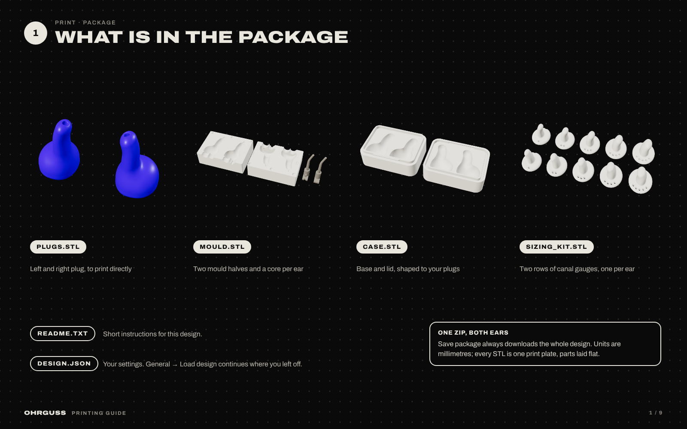
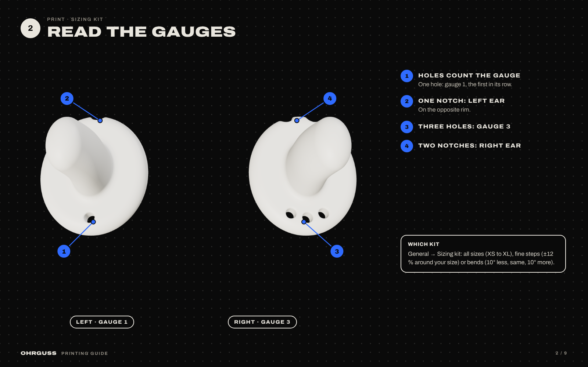
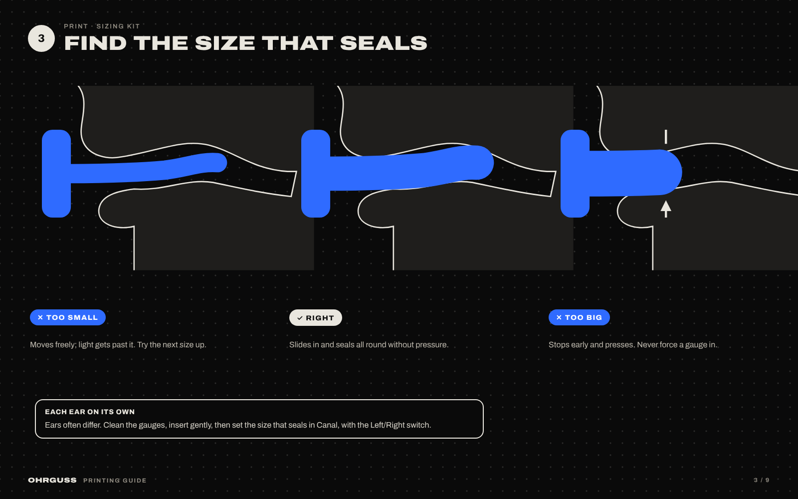
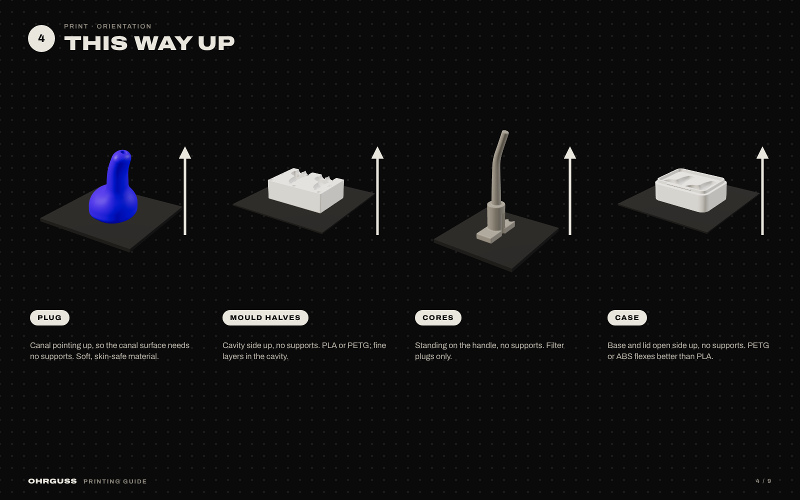
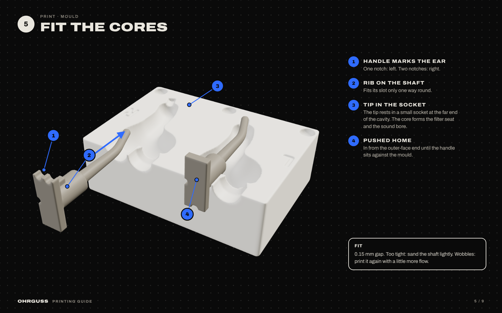
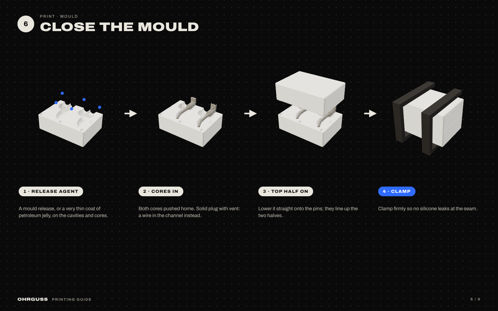
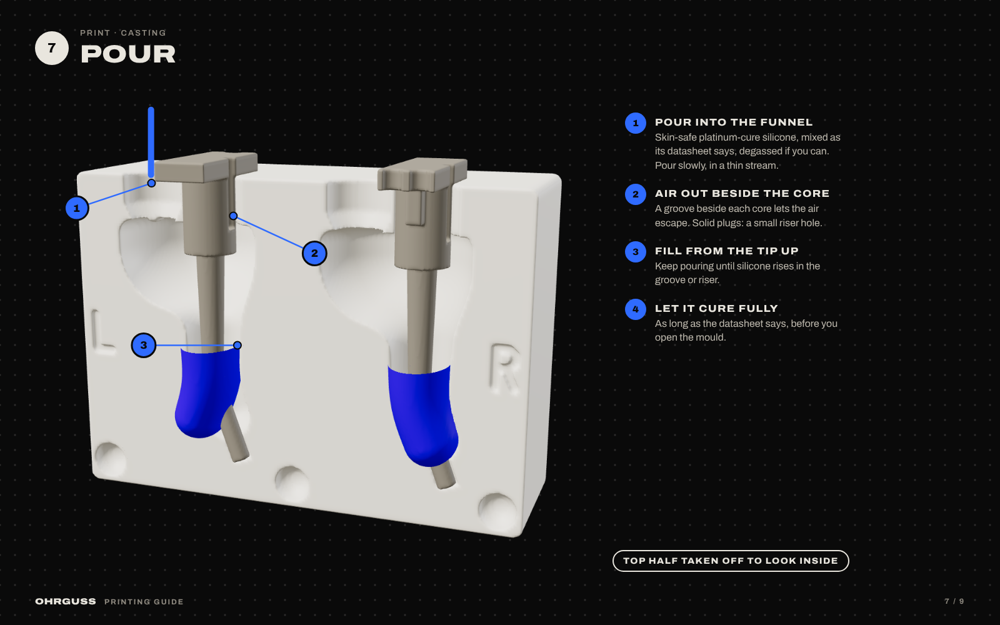
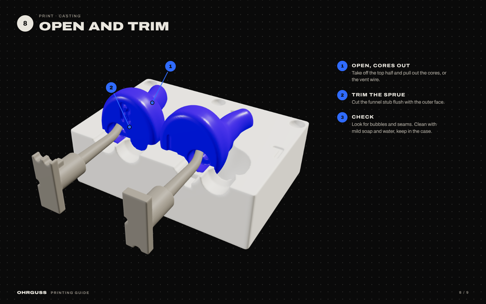
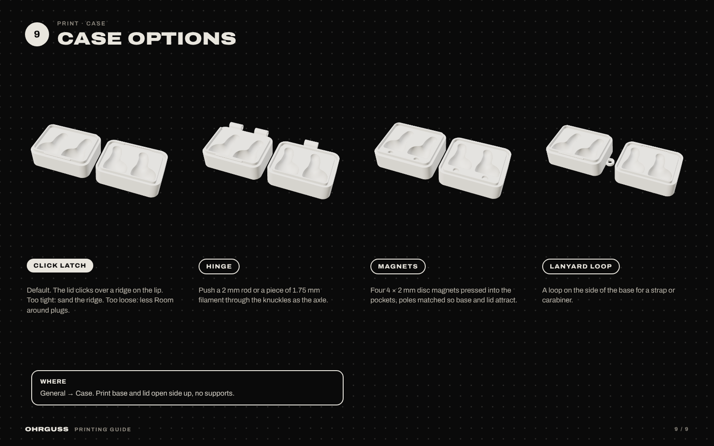

# Printing and casting guide

> **Not certified hearing protection.** Plugs made from these files have no tested attenuation. Use certified hearing protection wherever protection is required, for example at work. Check the fit and seal before relying on a plug, and stop using it if it hurts.

To scan your ear or use a photo first, see the [scanning guide](scanning.md). Nothing in this guide has been verified on a real print yet. The values are starting points; please report what works on your printer.

## What is in the package

**Save package** in the app downloads one zip for the whole design (both ears). Units are millimetres; every STL is one print plate with the parts laid flat.

| File | Contents |
|---|---|
| `plugs.stl` | Left and right plug, for direct printing |
| `mould.stl` | Both mould halves (cavity side up) and, for filter plugs, one core per ear |
| `case.stl` | Case base and lid, shaped to your two plugs |
| `sizing_kit.stl` | Two rows of canal gauges, one row per ear |
| `README.txt` | Short instructions for this design |
| `design.json` | Your settings; load it in **General → Load design** to continue later |

## 1. Find your canal size with the sizing kit

Print the sizing kit first. Each gauge is a canal tip on a flat flange.

- **Which gauge is which:** small holes in the rim count the gauge (1 hole = first gauge). One notch on the opposite rim means left ear, two notches mean right ear.
- **Kit contents** (General → Sizing kit):
  - *All sizes:* XS to XL with that ear's length and bend.
  - *Fine steps:* five gauges around your current size, from 12 % smaller to 12 % larger.
  - *Bends:* your current size with 10° less bend, the same, and 10° more.

- **Testing:** clean the gauges, insert gently, never force one in. The right size seals comfortably without pressure. Then set that size in the Canal menu for that ear.

Print the gauges in a smooth material with a fine layer height, and remove any sharp edges.

## 2a. Print the plugs directly

The simplest route. Use a soft, skin-safe material:

- **Resin printer:** a flexible resin sold as skin-safe or biocompatible. Skin safety depends on the full process, including washing and curing, so follow the resin maker's instructions exactly.
- **Filament printer:** possible with a soft TPU, but surfaces are rougher and the material is usually not certified for skin contact. Fine for fit tests.

Orient each plug with the canal pointing up, so the canal surface needs no supports.

## 2b. Cast silicone plugs in the mould

Casting gives soft, smooth, skin-safe plugs from a filament printer.

### Print the mould

- **Halves:** print both halves cavity side up, no supports. PLA or PETG; a fine layer height in the cavity area gives a smoother plug.
- **Cores** (filter plugs only): print each core standing on its handle, no supports. The core forms the filter seat and the sound bore. By default it tapers from 3 mm at the seat to your bore size at the tip, which keeps it sturdy on filament printers. For resin printers you can switch off **Tapered bore core** in General to get a constant bore.
- Fit between core and pocket is 0.15 mm. If a core is too tight, sand the shaft lightly; if it wobbles, print it again with a slightly larger flow.

### Assemble

1. Apply a mould release (or a very thin coat of petroleum jelly) to the cavities and cores.
2. Push each core into its pocket at the outer-face end. The rib on the shaft only fits one way, and the core tip rests in a small socket at the far end of the cavity. One notch on the handle means left, two notches mean right.
3. **Solid plug with pressure vent:** lay a wire of the vent width in the channel of each cavity instead. It is pulled out after curing.
4. Close the halves; the pins locate them. Clamp them firmly.

### Pour

1. Mix a skin-safe silicone (platinum cure, made for skin contact or ear moulds) as its datasheet says. Degas it if you can.
2. Pour slowly through the funnel of each cavity. With the cord ring or removal grip switched on, the funnel enters through the ring or grip.
3. Air escapes through the groove beside each core (filter plugs) or through the small riser hole (solid plugs). Fill until silicone rises there.
4. Let it cure fully, then open the halves, pull out the cores (or the vent wire) and trim the sprue.

## 3. Print the case

- Print base and lid open side up, no supports.
- **Click latch** (default): the lid clicks over a ridge on the lip. PETG or ABS flexes better than PLA. If it is too tight, sand the ridge; if it is too loose, reduce **Room around plugs**.
- **Hinge** (General → Case): push a 2 mm rod or a piece of 1.75 mm filament through the knuckles as the axle.
- **Magnets:** press four 4 × 2 mm disc magnets into the pockets, with matching poles so base and lid attract.
- **Lanyard loop:** a loop on the side of the base for a strap or carabiner.

## Tolerances to tune

| Setting | Default | Where |
|---|---|---|
| Mould core in pocket | 0.15 mm gap | fixed |
| Room around plugs in the case | 0.5 mm | General → Case |
| Filter in its seat (uploaded filter) | 0.15 mm gap | Filter → Your filter |
| Mould wall | 5 mm | General → Mould |

## Care

Clean plugs with mild soap and water, let them dry, and keep them in the case. Replace them if the material cracks, hardens or no longer seals.
