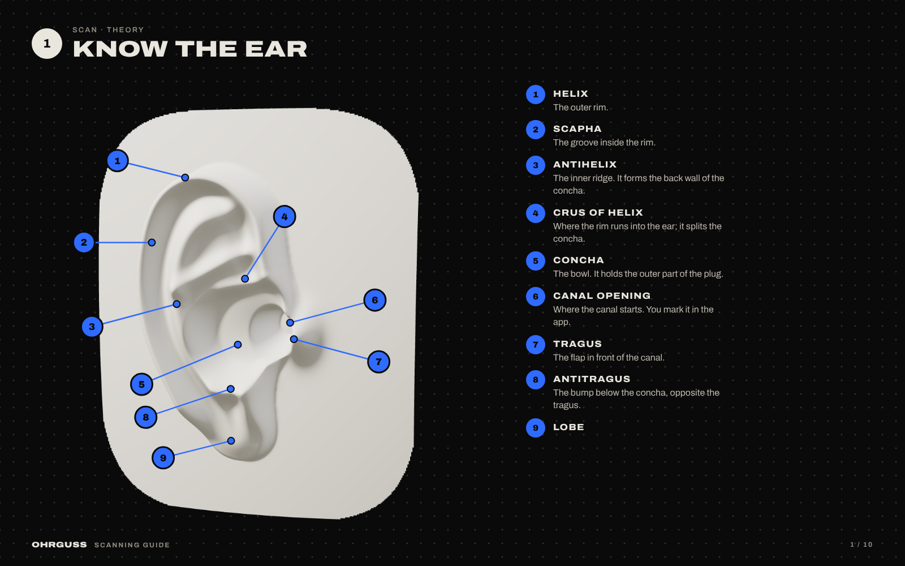
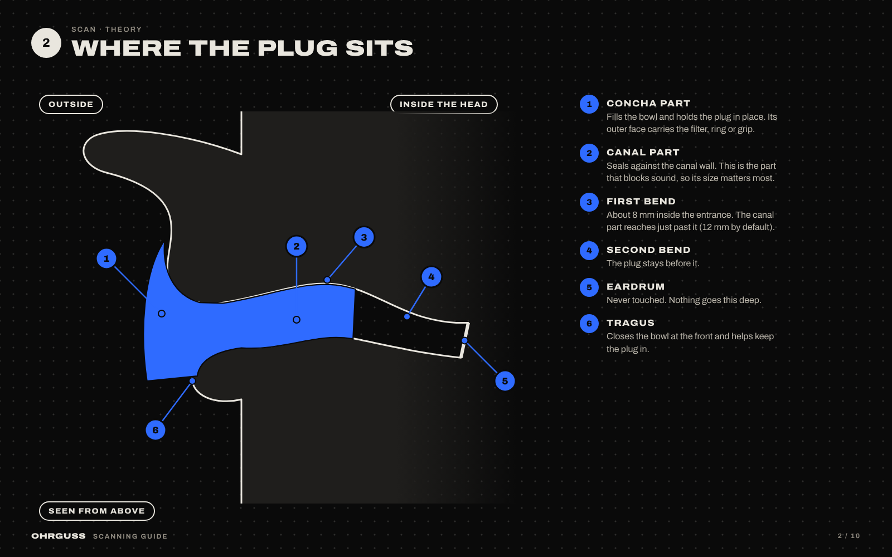
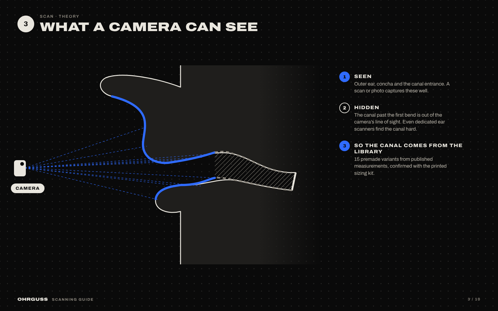
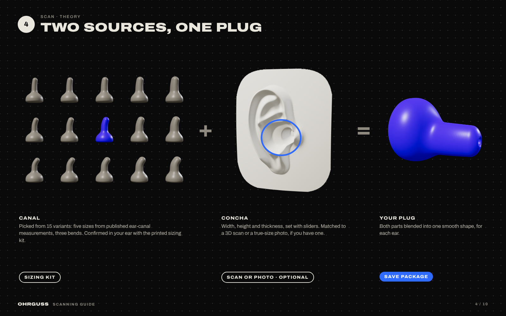
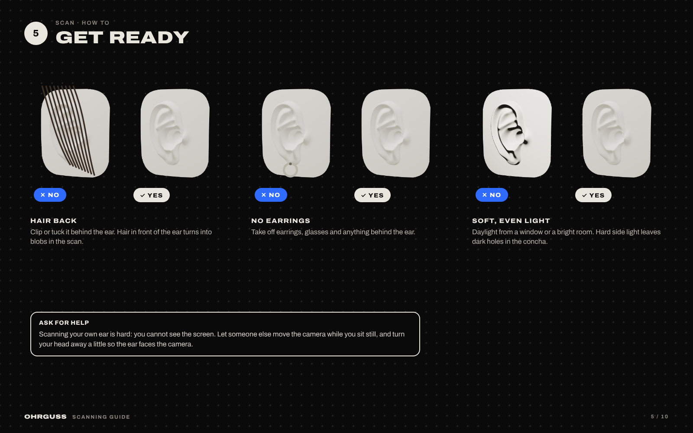
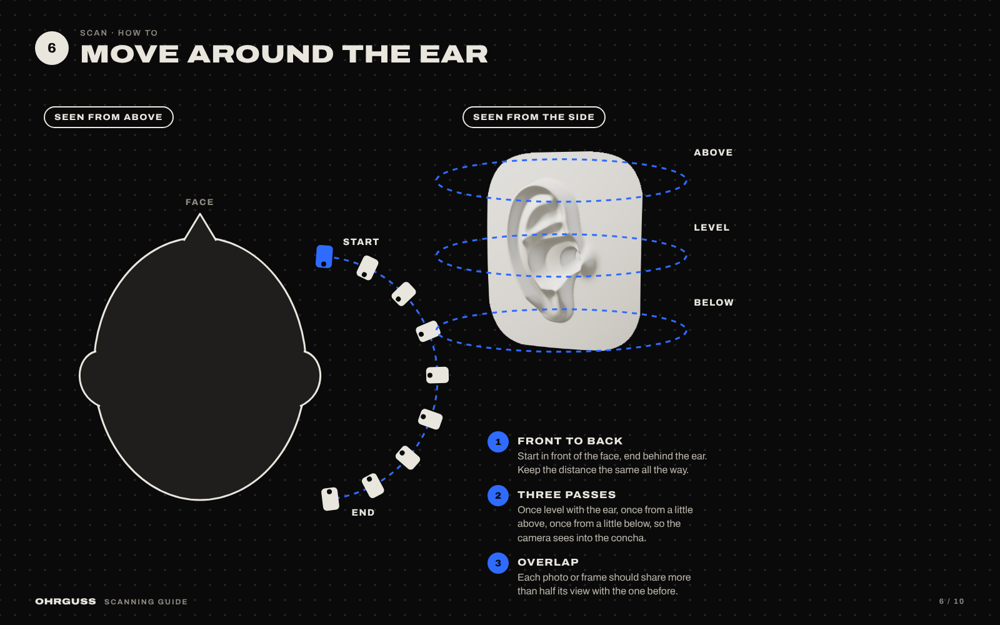
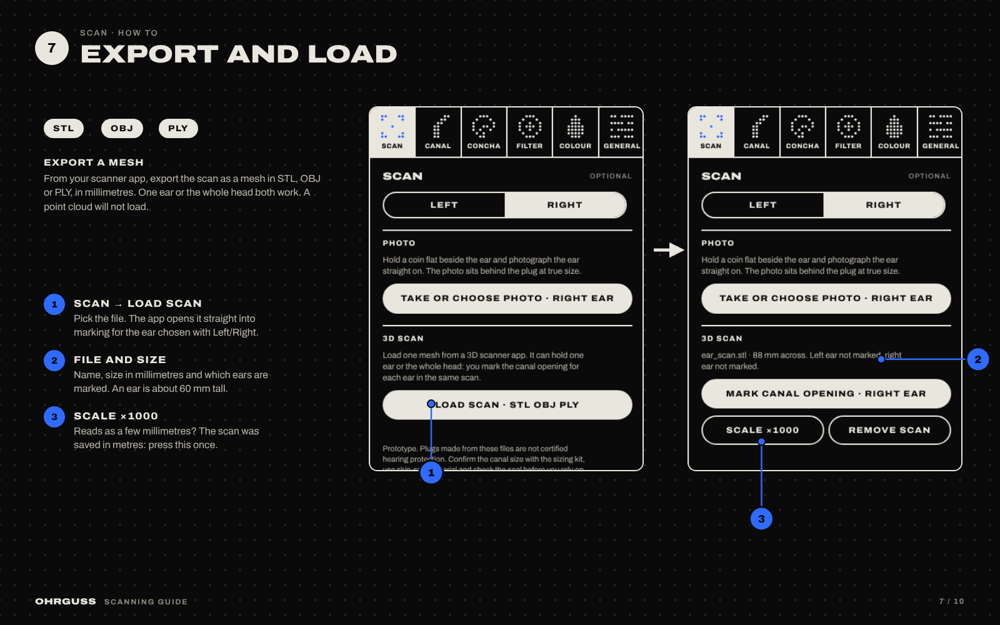
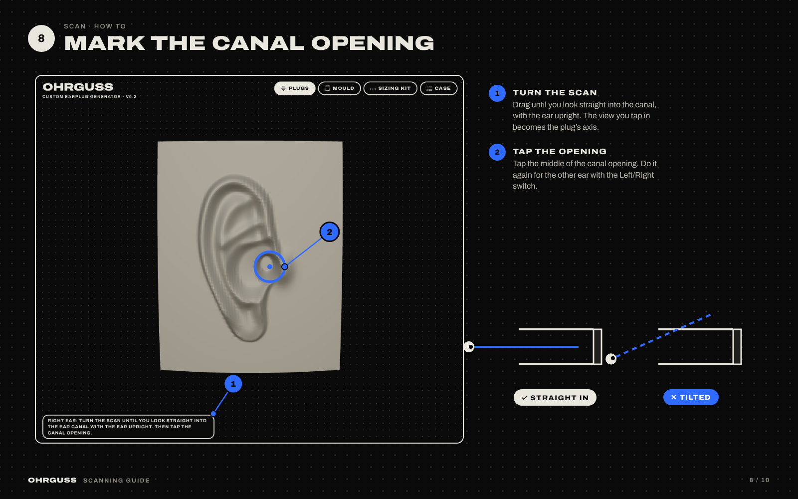
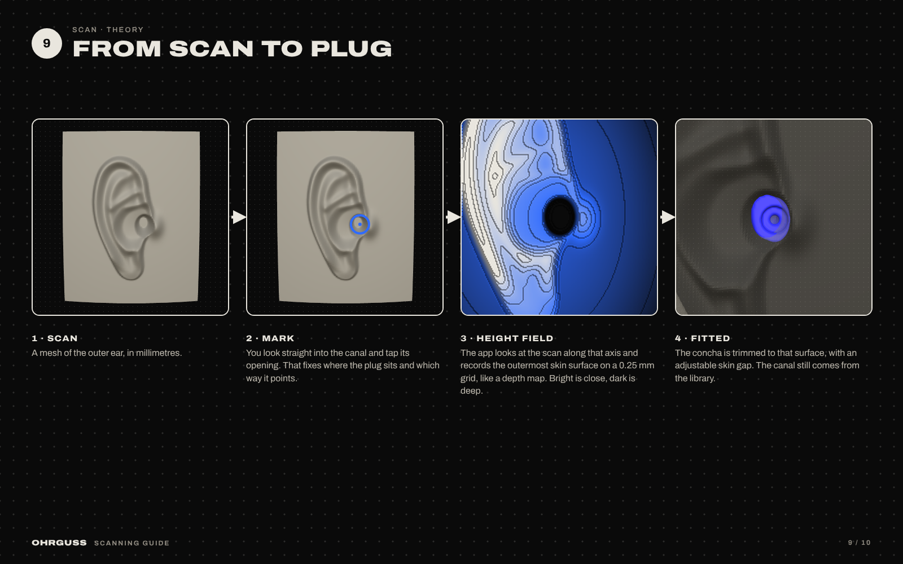
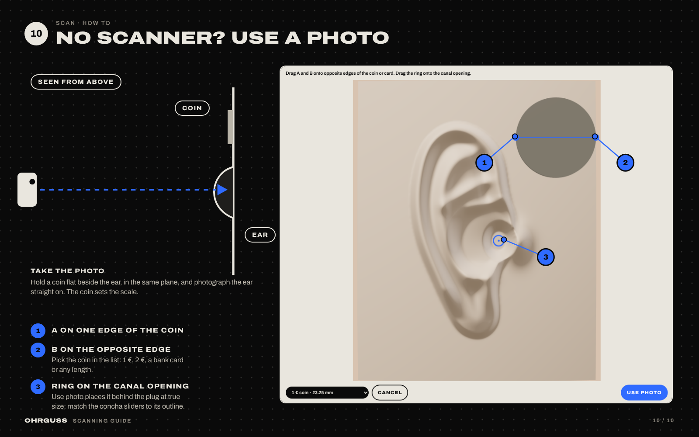

# Scanning guide

How Ohrguss uses a scan or a photo of your ear, and how to make one. Scanning is optional: without it, the concha is set with sliders and the canal still comes from the library and the sizing kit.

> [!NOTE]
> The ear in these pictures is a synthetic model made for this guide, not a real person's ear. Nothing here has been tested with real ear scans yet; please report what works.

## How it works

### Know the ear

The plug touches two areas: the **concha**, the bowl in the middle of the outer ear, and the **canal**, which starts at the canal opening behind the tragus.

### Where the plug sits

- The **concha part** fills the bowl and holds the plug in place. Its outer face carries the filter, cord ring or grip.
- The **canal part** seals against the canal wall. This is the part that blocks sound, so its size matters most.
- The canal bends twice. The first bend is about 8 mm inside the entrance; the canal part of the plug reaches just past it (12 mm by default) and stays before the second bend.

### What a camera can see

A phone camera sees the outer ear, the concha and the canal entrance. The canal behind the first bend is out of its line of sight, and even dedicated ear scanners find it hard ([3DBODY.TECH 2015](https://proc.3dbody.tech/abstracts/2015/175hatzilias.html)). The canal also changes shape when the jaw moves ([Unal et al.](https://research.sabanciuniv.edu/id/eprint/10697/1/52410518.pdf)).

### Two sources, one plug

So Ohrguss splits the plug:

- **Canal:** picked from 15 variants (five sizes from published ear-canal measurements, three bends) and confirmed in your ear with the printed [sizing kit](printing.md#1-find-your-canal-size-with-the-sizing-kit).
- **Concha:** width, height and thickness, set with sliders, and matched to a 3D scan or a true-size photo if you have one.

Background and sources: [concept and research](concept.md).

## Make a 3D scan

Any scanner app that exports a mesh works. A 2026 comparison of phone methods found photogrammetry and the front depth camera detailed enough for the outer ear, and the rear LiDAR sensor too coarse ([Forum Acusticum 2026](https://dael.euracoustics.org/confs/fa2026/data/articles/000152.pdf)).

### 1. Get ready

- **Hair back.** Clip or tuck it behind the ear; hair in front of the ear turns into blobs.
- **No earrings,** glasses or anything behind the ear.
- **Soft, even light.** Daylight from a window or a bright room. Hard side light leaves dark holes in the concha.
- **Ask for help.** You cannot see the screen while scanning your own ear. Let someone else move the camera while you sit still.

### 2. Move around the ear

- Start in front of the face and end behind the ear, keeping the distance the same.
- Make three passes: level with the ear, a little above and a little below, so the camera sees into the concha.
- Each photo or frame should share more than half its view with the one before.

### 3. Export and load

1. Export the scan as a **mesh** in STL, OBJ or PLY, in millimetres. One ear or the whole head both work; a point cloud will not load.
2. In the app, open **Scan → Load scan** and pick the file. It opens straight into marking for the ear chosen with Left/Right.
3. Check the size shown under the file name: an ear is about 60 mm tall. If the scan reads as a few millimetres, it was saved in metres: press **Scale ×1000**.

### 4. Mark the canal opening

1. Drag to turn the scan until you look **straight into the canal**, with the ear upright. The view you tap in becomes the plug's axis, so a tilted view tilts the plug.
2. Tap the middle of the canal opening.
3. For the other ear, switch Left/Right and press **Mark canal opening** again. Both ears can come from the same head scan.

### 5. From scan to plug

1. **Scan:** a mesh of the outer ear.
2. **Mark:** your tap fixes where the plug sits and which way it points.
3. **Height field:** the app looks at the scan along that axis and records the outermost skin surface on a 0.25 mm grid, like a depth map.
4. **Fitted:** with **Fit concha to scan** on, the concha is trimmed to that surface, with an adjustable **Skin gap**. The canal still comes from the library.

The scan stays in your browser; nothing is uploaded.

## No scanner: use a photo

1. Hold a coin flat beside the ear, in the same plane, and photograph the ear straight on.
2. In **Scan → Take or choose photo**, drag **A** and **B** onto opposite edges of the coin and pick the coin in the list (1 €, 2 €, a bank card or any length).
3. Drag the **ring** onto the canal opening and press **Use photo**.
4. The photo now sits behind the plug at true size. Match the plug to its outline with the sliders in **Concha**.

A photo gives the outline of the concha, not its depth; set the thickness by feel and check it with a test print.
